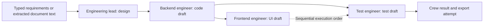

# DevPilot: Software Engineering Team with CrewAI

**Translate a software brief into architecture, backend and frontend code drafts, and test artifacts through four specialized AI roles.**

This project explores how an AI-assisted development workflow can move beyond a single code-generation prompt. An engineering lead prepares a design; a backend engineer receives that design; a frontend engineer receives the backend task's output; and a test engineer receives backend context to propose tests.

The implementation combines a Gradio requirements interface, document extraction, YAML-defined roles and tasks, sequential CrewAI orchestration, file-writing tools, and ZIP-export code. The repository also contains a video-platform example with design, service, frontend, and test artifacts that reviewers can inspect directly.

**Status:** a development-workflow prototype with committed example artifacts. Generated code requires review and repair. The repository does not establish that arbitrary requirements become working, secure, or production-ready applications, or that generated tests pass.

[Explore the implementation](https://github.com/FaiazS/Software-Engineering-Team/tree/main/Software-Engineering-Team-main/software_engineering_team) · [Crew orchestration](https://github.com/FaiazS/Software-Engineering-Team/blob/main/Software-Engineering-Team-main/software_engineering_team/src/software_engineering_team/crew.py) · [Inspect the example artifacts](https://github.com/FaiazS/Software-Engineering-Team/tree/main/Software-Engineering-Team-main/software_engineering_team/src/software_engineering_team/video_streaming_platform)

## Why this workflow matters

Turning a business brief into software involves several different decisions: interpreting requirements, defining boundaries, choosing interfaces, implementing behavior, and checking the result. This project makes those stages explicit and passes their outputs through a structured sequence.

Its intended value is to produce material a developer can inspect, refine, and test during prototyping. It does not replace engineering judgment or prove a reduction in delivery time.

| Workflow element | Practical purpose |
|---|---|
| Text and document intake | Accept a brief in the form a requester already has |
| A separate design task | Capture architecture decisions before requesting implementation |
| Backend-to-frontend context | Give the UI-generation task implementation context rather than only the original brief |
| A separate QA role | Make test generation an explicit stage of the workflow |
| Source and design artifacts | Let developers examine what was produced rather than only a chat response |
| Export code | Work toward collecting outputs for local review and continued development |

## The four-agent team

The crew is declared with `@CrewBase` and uses `Process.sequential`. It is a staged workflow, not four agents running in parallel.

| Agent | Task | Explicit task context | Output intent |
|---|---|---|---|
| Engineering lead | `software_design_task` | User requirements | A Markdown design describing modules, classes, interactions, and tradeoffs |
| Backend engineer | `backend_code_task` | Design task | Backend code and setup information; prompted to write files |
| Frontend engineer | `frontend_code_task` | Backend task | UI code and integration assumptions; prompted to write files |
| Test engineer | `qa_task` | Backend task | Test source, framework rationale, and run instructions |



The YAML instructions request modularity, SOLID principles, design patterns, error handling, and security considerations. These are generation requirements, not mechanically enforced guarantees. QA explicitly receives backend context; no configured frontend-test validation gate is shown.

## Requirements intake and interface

`user_interface.py` defines two Gradio input paths:

- **Typed brief:** a text box passes requirements to the crew runner.
- **Uploaded document:** extension checks accept PDF, DOCX, or TXT, extract text, and pass it to the same workflow.

The source enforces a **30-page PDF limit**. For DOCX, it estimates pages using 400 words per page; it does not read the rendered Word page count. TXT input has no equivalent page-count check. PDF extraction uses `pdfplumber`; no OCR path is implemented for scanned images.

The UI yields status messages around the crew call and displays formatted text. Several messages are delayed with `time.sleep()`; this is not a stream of actual per-agent progress events. A “Code Only / Code + Summary” selector exists, but its value is not used by the processing function.

The text-input path returns a ZIP path to a Gradio file component. The document-input path currently yields Markdown only, so an equivalent downloadable file result is not wired to that tab.

## Concrete example: video-platform artifacts

[View the committed example](https://github.com/FaiazS/Software-Engineering-Team/tree/main/Software-Engineering-Team-main/software_engineering_team/src/software_engineering_team/video_streaming_platform)

The repository includes tangible artifacts aligned with the workflow:

| Artifact | What is present |
|---|---|
| [Design document](https://github.com/FaiazS/Software-Engineering-Team/blob/main/Software-Engineering-Team-main/software_engineering_team/src/software_engineering_team/video_streaming_platform/output/software_design.md) | A proposed separation into user, video, editing, notification, and integration services |
| Backend modules | Five FastAPI service-module files and an application-mounting entry point |
| Frontend source | React components for a video list/detail view and a notification example, plus setup text containing additional component snippets |
| Test artifacts | Five Python test files and fuller test snippets in a saved crew summary |
| [Saved run summary](https://github.com/FaiazS/Software-Engineering-Team/blob/main/Software-Engineering-Team-main/software_engineering_team/src/software_engineering_team/video_streaming_platform/output/run_20250630_181443/summary.md) | QA-style output describing tests and local commands |
| Archive | A committed ZIP file alongside the saved run directory |

**Artifact presence is not a passing build or test report.** The sample has incomplete tests, inconsistent imports/routes, and frontend/backend contract mismatches. Its account data lives in memory, its token is a placeholder, editing returns example strings, and external sharing returns a message rather than calling YouTube or Vimeo. It is not a working video-streaming deployment.

## Output packaging

`save_crew_output_to_disk()` creates a timestamped run folder, writes `summary.md`, and zips that folder. It writes additional source files only when it finds a dictionary on a `raw_output` attribute.

That custom assumption needs alignment with the actual CrewAI result structure. Files created separately through `FileWriterTool` are not automatically collected by this function. The committed extracted run directory contains a summary, while sample source files live elsewhere in the example tree. A ZIP download should therefore not be presented as a verified, complete project bundle.

The timestamp uses second-level precision, so concurrent runs also need isolated output paths. A future packaging pass should validate every artifact, enforce safe relative paths, and build the archive from an explicit manifest.

## Configuration and technology

- **Python:** `>=3.10,<3.14` in `pyproject.toml`.
- **Orchestration:** CrewAI, with YAML agent/task configuration and Python decorators.
- **File-writing capability:** `crewai_tools.FileWriterTool` on the backend, frontend, and QA agents.
- **Code execution configuration:** those three agents request code execution with `code_execution_mode="safe"`, a 300-second execution limit, and seven retries.
- **Interface/document handling:** Gradio, pdfplumber, and python-docx.
- **Export:** pathlib, zipfile, and filesystem utilities.
- **Packaging:** Hatchling, uv lockfiles, and console entry-point declarations.

The project-level lockfile records CrewAI **0.130.0**, crewai-tools **0.47.1**, and LiteLLM **1.72.0**. The package manifest and standalone requirements specify different dependency ranges and do not cover the UI identically. A single tested environment remains necessary.

### Model assignments in the YAML

| Role | String declared under `model` |
|---|---|
| Engineering lead | `groq/llama-3.1-70b-versatile` |
| Backend engineer | `groq/deepseek-r1-distill-llama-70b` |
| Frontend engineer | `groq/llama-3.1-8b-instant` |
| Test engineer | `gemini-2.5-flash` |

These are configuration strings, not verified active model routes. CrewAI documents the agent model parameter as `llm`; the YAML's `model` key needs checking against the installed version. The historical DeepSeek Groq model ID has also been retired. See [CrewAI agent configuration](https://docs.crewai.com/en/concepts/agents) and [Groq's deprecation notice](https://console.groq.com/docs/deprecations).

## Repository map

```text
Software-Engineering-Team/
├── README.md
└── Software-Engineering-Team-main/
    ├── PROJECT_DOCUMENTATION.md
    ├── README.md
    └── software_engineering_team/
        ├── pyproject.toml
        ├── requirements.txt
        ├── uv.lock
        ├── knowledge/
        └── src/software_engineering_team/
            ├── app.py
            ├── main.py
            ├── crew.py
            ├── user_interface.py
            ├── config/
            │   ├── agents.yaml
            │   └── tasks.yaml
            ├── tools/custom_tool.py
            ├── utils/write_output.py
            └── video_streaming_platform/
                ├── user_service/
                ├── video_service/
                ├── editing_service/
                ├── notification_service/
                ├── integration_service/
                ├── src/
                ├── frontend/
                ├── tests/
                └── output/
```

The custom-tool file is a scaffold and is not attached to the crew. A knowledge text file is present, but the shown crew configuration does not wire it as a knowledge source.

## Implementation status

<details>
<summary><strong>Expand the issues that need attention before a reliable demo</strong></summary>

| Area | Source finding |
|---|---|
| Credential logging | `main.py` prints the complete `GROQ_API_KEY` and `GEMINI_API_KEY` values. Remove those statements before running with credentials; rotate keys if these logs were exposed. |
| Model/config contracts | Validate the YAML `model` field, other agent options, and task `output_dir` values against the locked CrewAI version. Prompts naming output directories do not ensure complete artifacts in those directories. |
| CLI/package entry points | The declared console target calls `run`, which requires a `user_requirements` argument. Other declared train/replay/test functions are absent from the shown `main.py`, and local imports need package-aware cleanup. |
| Referenced configuration | `LITELLM_CONFIG_PATH` points to `.litellm/config.yaml`, which was not present in the inspected project tree. |
| Generated code extraction | Parsing the final output at the first Markdown fence and detecting a language with a keyword regex is not a reliable multi-file artifact format. |
| ZIP completeness | The archive writer only collects its run directory and depends on a custom `raw_output` dictionary for additional files. |
| Example test completeness | Three committed test files end inside a JSON argument and are syntactically incomplete. Fuller snippets in the saved summary are not substitutes for repaired test files. |
| Example test validity | Some login tests omit the email field required by the endpoint's input model; shared in-memory test state is not reset by fixtures. No passing report or coverage measurement is present. |
| Example integration | Service imports lack the shown exports, mount prefixes repeat endpoint prefixes, and video/editing apps are mounted under the same path. The React list request and video fields do not match the backend's implemented contract. |
| Example security/functionality | Passwords are stored as plain text in memory, the token is a constructed string, and media editing/external sharing are stubs. |

</details>

## Before running

The UI entry point is `src/software_engineering_team/app.py`. It imports the Gradio interface, whose handlers call `run(user_requirements)`. This describes the source entry path; execution was not verified for this README.

The runner checks for `GROQ_API_KEY` and `GEMINI_API_KEY`, but the credential-printing statements above must be removed first. Confirm provider routing, supported models, and dependencies in a private environment before making any calls.

The configured safe code-execution mode requires an appropriate Docker setup according to the [CrewAI documentation](https://docs.crewai.com/en/concepts/agents). It does not automatically isolate all file-writing paths or certify generated code. Run only against a disposable workspace with intentional file permissions and a defined model-call budget.

## Next engineering milestone

The strongest next step is a small, repeatable demonstration with acceptance checks:

1. Submit one bounded brief with explicit expected endpoints and data fields.
2. Capture each task's output in a structured artifact manifest.
3. Check generated files for completeness and syntax before attempting execution.
4. Build the backend and frontend, then check their API contracts against the same specification.
5. Collect tests successfully, run them, and retain the actual pass/fail report.
6. Package every validated file and report through an explicit manifest.
7. Record model versions, cost, duration, and human corrections for that run.

That would let reviewers assess the full chain from requirement to artifacts to verified behavior. Broader language/framework support and productivity claims should follow measured runs, rather than being inferred from prompt instructions.

## About the developer

I am transitioning from business and e-commerce operations into software and AI engineering. This project connects the two sides of that journey: expressing business requirements clearly and organizing the technical work needed to implement and validate them. My focus is on making agent workflows inspectable, testable, and useful to the developer who continues the work.

[Explore my GitHub projects](https://github.com/FaiazS) · [Connect on LinkedIn](https://www.linkedin.com/in/faiazahmed22/)

